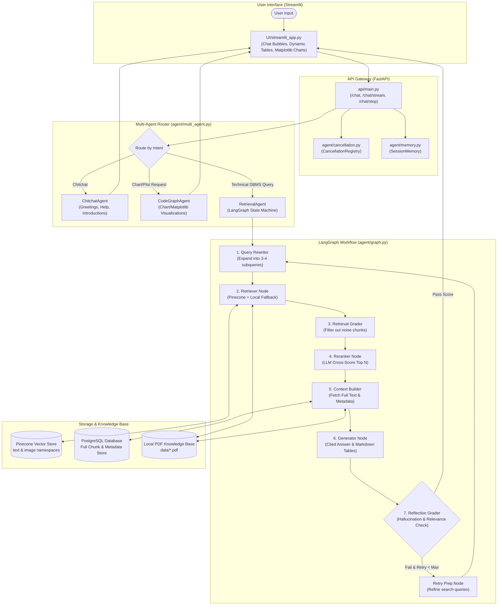

# OS databse rag retrieval — Comprehensive System Architecture & Deep Dive

## Table of Contents
1. [Executive Summary](#1-executive-summary)
2. [High-Level Architecture](#2-high-level-architecture)
3. [The Offline Ingestion Pipeline](#3-the-offline-ingestion-pipeline)
   - [Document Parsing & Multimodal Extraction](#document-parsing--multimodal-extraction)
   - [Chunking Strategy](#chunking-strategy)
   - [Embedding Generation](#embedding-generation)
   - [Dual-Store Indexing (Pinecone + PostgreSQL)](#dual-store-indexing-pinecone--postgresql)
4. [The Online Query & Multi-Agent Runtime](#4-the-online-query--multi-agent-runtime)
   - [Frontend UI (Streamlit)](#frontend-ui-streamlit)
   - [Backend API (FastAPI)](#backend-api-fastapi)
   - [In-Flight Cancellation Mechanism](#in-flight-cancellation-mechanism)
   - [Session Memory](#session-memory)
   - [Multi-Agent Routing Layer](#multi-agent-routing-layer)
5. [The LangGraph State Machine (Retrieval Engine)](#5-the-langgraph-state-machine-retrieval-engine)
   - [State Definition (`AgentState`)](#state-definition-agentstate)
   - [Node 1: Query Rewriter](#node-1-query-rewriter)
   - [Node 2: Hybrid & ColPali Retriever](#node-2-hybrid--colpali-retriever)
   - [Node 3: Retrieval Grader](#node-3-retrieval-grader)
   - [Node 4: LLM-Based Reranker](#node-4-llm-based-reranker)
   - [Node 5: Context Builder](#node-5-context-builder)
   - [Node 6: Generator (Grounded OS Answers)](#node-6-generator-grounded-dbms-answers)
   - [Node 7: Reflection Grader (Corrective RAG)](#node-7-reflection-grader-corrective-rag)
   - [Conditional Loop & Retry Preparation](#conditional-loop--retry-preparation)
6. [Resilience & Local Fallback Design](#6-resilience--local-fallback-design)
7. [Step-by-Step Walkthrough of an Example Query](#7-step-by-step-walkthrough-of-an-example-query)

---

## 1. Executive Summary

This project is an enterprise-grade **Agentic Retrieval-Augmented Generation (RAG)** system titled **OS databse rag retrieval**, specialized for **Operating Systems (OS)** and systems architecture. 

Unlike traditional naive RAG systems that simply convert queries into embeddings, search a vector store, and dump raw chunks into an LLM context window, this system employs:
- **Agentic Decision Making**: Dynamically classifies intent and routes queries to dedicated agents (Chitchat, Chart Generator, or LangGraph Retrieval).
- **Corrective RAG (CRAG) & Self-Reflection**: Validates whether retrieved documents are actually relevant before answering, and grades the quality of generated answers before returning them to the user.
- **Multimodal Understanding**: Extracts text, structured markdown tables, and diagrams from PDFs, slide decks, and spreadsheets.
- **Graceful Degradation**: Can run connected to cloud resources (Pinecone, PostgreSQL, OpenAI/OpenRouter) or automatically degrade to local keyword and in-memory fallback parsing if external databases are offline.
- **Responsive Generation & Real Server Cancellation**: Supports Server-Sent Events (SSE) streaming and server-side cancellation tokens that truly abort running LLM and vector tasks when a user presses "Stop".

---

## 2. High-Level Architecture



---

## 3. The Offline Ingestion Pipeline

Before queries can be answered with citations, the 7 reference PDFs in `data/` are ingested and indexed via `scripts/ingest.py`.

```text
PDF / Office Files (data/*.pdf)
       │
       ▼
[ingestion/parser.py] ────────► PyMuPDF & pdfplumber extract Text, Tables & Images
       │
       ▼
[ingestion/chunker.py] ───────► Creates ~800 char IndexableChunks with persistent IDs
       │
       ▼
[ingestion/embedder.py] ──────► Embeds text via OpenAI (text-embedding-3-large)
       │                         + GPT-4o Vision captions for diagrams
       ▼
[ingestion/indexer.py] ───────► Pinecone: Vector embeddings + short preview
                               PostgreSQL: Full chunk text + structured metadata
```

### Document Parsing & Multimodal Extraction
- Handled by `ingestion/parser.py`.
- **Text & Layout**: Uses `PyMuPDF` (`fitz`) to extract page layout, section titles, headers, and body paragraphs.
- **Tables**: Uses `pdfplumber` for precise tabular grid recognition, formatting extracted tables into clean GitHub-flavored markdown.
- **Images/Diagrams**: Identifies diagrams (e.g., B+ Tree structures, ARIES log sequences, ACID state machines) and extracts raw image buffers.

### Chunking Strategy
- Handled by `ingestion/chunker.py`.
- Divides parsed text into semantic chunks of roughly **800 characters** with an overlap of **150 characters**.
- Generates a deterministic `chunk_id` formatted as:
  `{source_filename}__p{page_or_slide}__{chunk_type}__{index}`
  *(e.g., `04_DBMS_Transaction_Management_and_Concurrency_Control.pdf__p12__text__0`)*.
- Attaches metadata including `source_file`, `page_or_slide`, `doc_type`, `topic`, and `section_title`.

### Embedding Generation
- Handled by `ingestion/embedder.py`.
- Text chunks are encoded into 1536-dimensional vectors using `text-embedding-3-large`.
- Embedded images and diagrams are sent to `GPT-4o Vision` to generate rich descriptive captions; the captions are then embedded to enable semantic searching of visual diagrams.
- Supports optional page-level visual embedding via ColPali.

### Dual-Store Indexing (Pinecone + PostgreSQL)
- Handled by `ingestion/indexer.py`.
- **Pinecone**: Acts as the rapid vector index (`dbms-rag-openai`). Stores only vectors, `chunk_id`, and a short `content_preview` to minimize vector payload overhead.
- **PostgreSQL**: Stores the complete un-truncated text, structured table strings, page images (Base64), and complete metadata dictionaries in the `chunks` table.

---

## 4. The Online Query & Multi-Agent Runtime

### Frontend UI (Streamlit)
Located at `UI/streamlit_app.py`:
- Built with standard Streamlit components for stability and clean aesthetics.
- **Streaming Support**: Uses Server-Sent Events (`/chat/stream`) or falls back to `/chat`. It polls tokens in a background thread at ~10 Hz so the interface remains fluid.
- **Real Stop Generation**: Contains a "Stop" button that immediately halts client-side streaming and transmits a cancellation signal to the backend.
- **Rich Output Rendering**:
  - Automatically parses markdown tables into native HTML/Streamlit tables.
  - Automatically renders base64-encoded charts and matplotlib plots generated by the backend.
  - Displays interactive expanders for citations and agent execution steps.

### Backend API (FastAPI)
Located at `api/main.py`:
- `POST /chat`: Synchronous JSON endpoint returning complete answer, citations, agent trace, and tables.
- `POST /chat/stream`: SSE streaming endpoint providing real-time token events (`{"type": "token", "text": "..."}`).
- `POST /chat/stop`: Signals the cancellation registry for the given `session_id`.
- `POST /chat/reset`: Clears session conversation history in memory.
- `GET /health` & `GET /status`: Health diagnostics, database connection status, and index statistics.

### In-Flight Cancellation Mechanism
Located at `agent/cancellation.py`:
- In standard LangChain/LangGraph applications, aborting an HTTP client request leaves the server continuing expensive LLM generation.
- Here, every in-flight request receives a `CancellationToken`.
- Every LangGraph node and multi-agent loop executes `await token.raise_if_cancelled()` before starting and between token iterations. If the user hits "Stop", all background processing and LLM calls terminate immediately.

### Session Memory
Located at `agent/memory.py`:
- Thread-safe sliding window buffer per `session_id`.
- Retains the last 10 conversation turns (20 messages total) to preserve context during multi-turn follow-up questions while preventing prompt bloat.

### Multi-Agent Routing Layer
Located at `agent/multi_agent.py`:
When a query enters `route_and_run()`, it is evaluated against specialized agents:

1. **`ChitchatAgent`**:
   - Detects conversational queries (e.g., *"Hello"*, *"Who made you?"*, *"What can you do?"*).
   - Bypasses vector retrieval entirely, answering immediately with zero Pinecone/Postgres latency.
2. **`CodeGraphAgent`**:
   - Detects requests to generate graphs, performance charts, or comparative plots (e.g., *"Plot B+ Tree vs Hash Index lookup cost across 1M records"*).
   - Generates executable Python code using `matplotlib`, executes it securely in an isolated runtime, and captures the resulting plot as a base64 image returned directly to the UI.
3. **`RetrievalAgent`**:
   - Handles all technical DBMS questions by triggering the full LangGraph state machine.

---

## 5. The LangGraph State Machine (Retrieval Engine)

The core technical intelligence resides in `agent/graph.py` and `agent/nodes.py`.

```text
       START
         │
         ▼
 ┌──────────────────────┐
 │  query_rewriter      │  (Decomposes question into 3-4 distinct search queries)
 └───────┬──────────────┘
         ▼
 ┌──────────────────────┐
 │  retriever           │  (Queries Pinecone/Local cache; gathers candidate chunks)
 └───────┬──────────────┘
         ▼
 ┌──────────────────────┐
 │  retrieval_grader    │  (Filters irrelevant or noisy candidate chunks)
 └───────┬──────────────┘
         ▼
 ┌──────────────────────┐
 │  reranker            │  (Scores and sorts chunks; selects top N)
 └───────┬──────────────┘
         ▼
 ┌──────────────────────┐
 │  context_builder     │  (Pulls full text from Postgres / local PDF cache)
 └───────┬──────────────┘
         ▼
 ┌──────────────────────┐
 │  generator           │  (Synthesizes answer with inline markdown citations)
 └───────┬──────────────┘
         ▼
 ┌──────────────────────┐
 │  reflection_grader   │  (CRAG self-assessment: checks hallucination & accuracy)
 └───────┬──────────────┘
         │
         ├──────────────────────────────┐
         ▼                              ▼
   [Score Satisfied]             [Score Poor & Retry < 2]
         │                              │
         ▼                              ▼
        END                     ┌──────────────────┐
                                │   retry_prep     │
                                └───────┬──────────┘
                                        │ (Loop back with refined prompt)
                                        └────► query_rewriter
```

### State Definition (`AgentState`)
The state dictionary passed through every node includes:
- `question`: Original user question.
- `chat_history`: Prior conversation turns.
- `rewritten_queries`: List of rewritten sub-queries.
- `raw_chunks`: Raw search results returned from vector/local search.
- `graded_chunks`: Chunks that passed the relevance grader.
- `reranked_chunks`: The top N most relevant chunks after cross-scoring.
- `full_chunks`: Chunks populated with full un-truncated text and metadata.
- `context`: Assembled prompt context string.
- `answer`: The synthesized assistant reply.
- `citations`: Extracted document citations (file, page number, section).
- `tables`: Extracted markdown tables.
- `reflection_loops`: Integer counting how many retry attempts have occurred.
- `cancel_token`: The cooperative cancellation token.

### Node 1: Query Rewriter (`query_rewriter_node`)
- Natural language questions often omit crucial DBMS keywords or contain conversational phrasing.
- An LLM analyzes the user prompt and conversation history, producing **3 to 4 optimized technical search queries** (e.g., breaking *"How do write-ahead logs help during crash recovery?"* into *"WAL protocol rules ARIES"*, *"Redo Undo log records recovery"*, and *"Checkpointing crash recovery"*).

### Node 2: Hybrid & ColPali Retriever (`retriever_node`)
- Executes parallel searches across all rewritten queries.
- Combines semantic text retrieval with image namespace queries in Pinecone.
- Deduplicates results by `chunk_id` and keeps the highest score for each unique chunk.
- Yields approximately 15–20 candidate chunks.

### Node 3: Retrieval Grader (`retrieval_grader_node`)
- Evaluates the relevance of each candidate chunk relative to the user query.
- Discards off-topic chunks that were retrieved purely due to vector proximity, preventing irrelevant context from confusing the generator.

### Node 4: LLM-Based Reranker (`reranker_node`)
- Instead of relying solely on vector similarity scores, an LLM evaluates the remaining chunks against the user question.
- Sorts candidate chunks based on true contextual relevance and selects the top **N** (configured by `RERANK_TOP_N=5`).

### Node 5: Context Builder (`context_builder_node`)
- Fetches the full text for the selected top N chunks from PostgreSQL (or from the local parser cache).
- Formats each chunk with clear document boundaries, source filenames, page numbers, and section headers.
- Formulates the exact prompt context fed into the final generator.

### Node 6: Generator (`generator_node`)
- Prompts the LLM with strict instructions:
  - Answers must be thoroughly grounded in the retrieved context.
  - Every technical claim must include an inline citation: `[Source: <filename>, Page <X>]`.
  - Structured comparisons must be presented as Markdown tables.
  - Complex sequences (e.g., 2PL locking phases, ARIES phases) must be step-by-step.
- Regex post-processors extract markdown tables and citations into dedicated structured fields in `AgentResult`.

### Node 7: Reflection Grader (`reflection_grader_node`)
- Implements **Corrective RAG (CRAG)** principles.
- Inspects the generated answer against the retrieved context:
  - *Is the answer faithful to the context (no hallucinations)?*
  - *Does the answer directly address the user's question?*
- Assigns a pass/fail determination and a confidence rating.

### Conditional Loop & Retry Preparation (`should_retry` & `retry_prep_node`)
- If the reflection grader passes: execution routes to `END`.
- If the answer fails AND `reflection_loops < MAX_REFLECTION_LOOPS`:
  - Enters `retry_prep_node`.
  - Increments loop counter and appends critique feedback.
  - Loops back to `query_rewriter_node` to search with refined constraints.

---

## 6. Resilience & Local Fallback Design

A key architectural strength of this codebase is **fault tolerance**:

1. **Vector Store Resilience**:
   - If Pinecone credentials are not configured or the network is unreachable, `agent/tools.py` automatically activates `_local_search()`.
   - `_local_search()` parses the local PDFs in `data/` in memory and performs keyword scoring, allowing the entire RAG pipeline to operate offline.
2. **Metadata Store Resilience**:
   - If PostgreSQL is down (e.g., Docker is not running), `fetch_full_chunk()` automatically catches the database connection error and retrieves the chunk text directly from the in-memory cache generated by `_get_local_chunks()`.
3. **ColPali Decoupling**:
   - The heavy ColPali visual model (5GB+) is gated behind `COLPALI_ENABLED=false` by default, preventing memory exhaustion on standard developer workstations while allowing instant activation when GPU acceleration is present.

---

## 7. Step-by-Step Walkthrough of an Example Query

### User Question:
> *"Explain how Two-Phase Locking (2PL) guarantees serializability and distinguish between Strict 2PL and Rigorous 2PL."*

| Step | Component | Action Performed |
|---|---|---|
| **1. UI Input** | `UI/streamlit_app.py` | Captures user prompt, registers request with `session_id`, starts SSE listener. |
| **2. API Reception** | `api/main.py` | Validates schema (`ChatRequest`), creates `CancellationToken`, retrieves conversation history from `SessionMemory`. |
| **3. Intent Routing** | `agent/multi_agent.py` | Determines the question is a technical DBMS question; delegates to `RetrievalAgent`. |
| **4. Query Rewriting** | `agent/nodes.py` (`query_rewriter_node`) | Generates subqueries: <br>• *"Two Phase Locking 2PL serializability theorem"*<br>• *"Strict 2PL cascading abort prevention"*<br>• *"Rigorous 2PL definition read write locks"*. |
| **5. Vector Retrieval** | `agent/tools.py` (`hybrid_retrieval`) | Embeds subqueries and retrieves candidate chunks from `04_DBMS_Transaction_Management_and_Concurrency_Control.pdf`. |
| **6. Reranking** | `agent/nodes.py` (`reranker_node`) | Evaluates chunks and selects the top 5 most informative chunks detailing Growing Phase, Shrinking Phase, and lock release rules. |
| **7. Full Context Assembly** | `agent/nodes.py` (`context_builder_node`) | Retrieves full paragraph text for each chunk and constructs the context prompt. |
| **8. Grounded Generation** | `agent/nodes.py` (`generator_node`) | Synthesizes explanation of 2PL, explains that 2PL guarantees conflict serializability by preventing cycles in the precedence graph, and produces a Markdown comparison table between Basic 2PL, Strict 2PL, and Rigorous 2PL. Inline citations are attached to each paragraph. |
| **9. Quality Reflection** | `agent/nodes.py` (`reflection_grader_node`) | Confirms the answer is fully supported by the retrieved document chunks and answers all parts of the question. Routes to `END`. |
| **10. Display** | `UI/streamlit_app.py` | Renders the text with markdown formatting, renders the comparison table cleanly, and populates the citation drawer with document titles and page numbers. |
